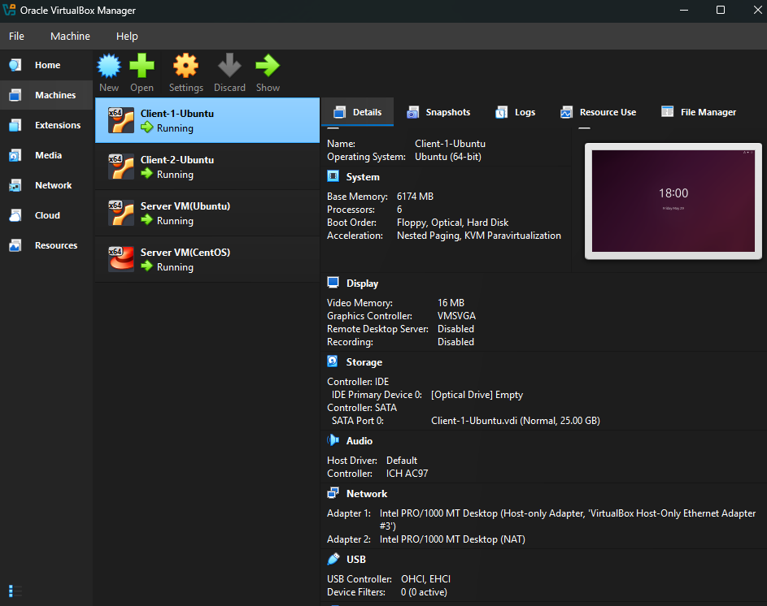

# Linux Network Services Implementation with Samba AD DC

## 📋 Project Overview

This is an individual project completed for the **Computer Systems Engineering** module at **Sri Lanka Institute of Information Technology (SLIIT)**. The project demonstrates the deployment and configuration of essential Linux network services using multiple virtual machines.

**Student IT Number:** IT24100816  
**Domain:** it16.local  
**Assignment:** Assignment 01 – Zimbra

---

## 🎯 Learning Outcomes Covered

- **LO4:** Develop systems level programs and describe how they are executed by the UNIX/Linux kernel
- **LO6:** Apply international standards to develop solutions to system programming tasks

---

## 🖥️ Environment



| Component | Details |
|-----------|---------|
| **Hypervisor** | Oracle VirtualBox |
| **Server OS** | Ubuntu 22.04.5 LTS |
| **Client OS** | Ubuntu 22.04.5 LTS (x2) |
| **Domain** | `it16.local` |
| **Network Range** | `192.168.16.0/24` |
| **DC IP** | `192.168.16.103` |

---

## ⚙️ Services Implemented

### 1. DHCP Server (CentOS/Ubuntu)
- Dynamically assigns IP addresses in range `192.168.16.100 - 192.168.16.200`
- Clients receive IP automatically

### 2. Zimbra Mail Server
- Mail domain: `mail.it16.local`
- Multiple user accounts created
- Email communication tested via web interface

### 3. Samba Active Directory Domain Controller
- Domain: `it16.local`
- Organizational Units: **Admins, Staff, Students**
- 3 users per level (9 users total)
- Ubuntu client joined to domain
- Domain authentication verified

### 4. Web Server (Apache)
- Publishes webpage with "HELLO NMA"
- Blue background
- Accessible from client machine

---

## 🚀 Setup Instructions

### Prerequisites
- VirtualBox installed
- Ubuntu 22.04.5 ISO
- Static IP configuration

### 1. Network Configuration
```bash
sudo nano /etc/netplan/50-cloud-init.yaml
